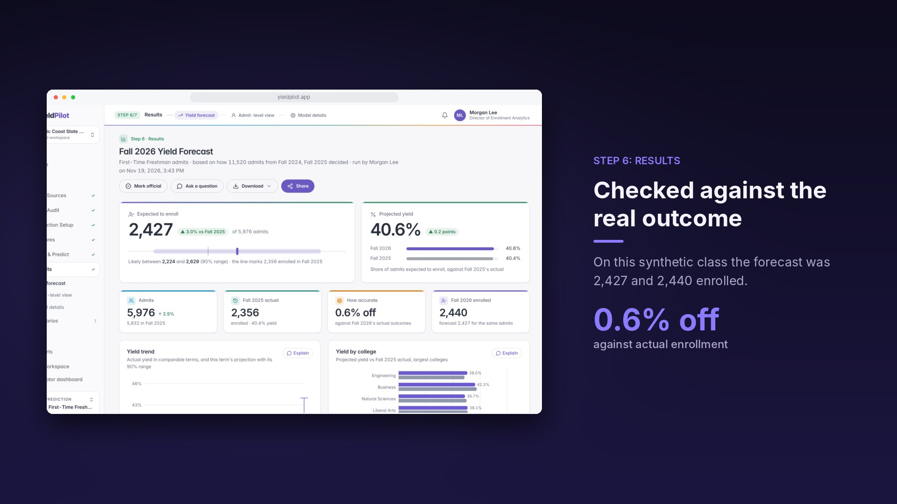

# YieldPilot

Admission yield forecasting for enrollment teams.

[](docs/media/yield-pilot-demo.mp4)

**Watch the 95-second product tour:** connect data, audit it, set up the prediction, choose features, train, review results against the actual class, run what-if scenarios and share an executive summary. Every student in the video is synthetic. ([download the mp4](docs/media/yield-pilot-demo.mp4))

| Result on the real Fall 2026 class (CSULB) | |
|---|---|
| Forecast vs actual enrollment | within 0.9% |
| Prior production model | 18.7% overestimate |

```
frontend/   Next.js (App Router) UI          → Cloud Run: yp-frontend
backend/    FastAPI API + forecasting engine → Cloud Run: yp-backend
docs/       System design and pilot plan
```

**GCP project:** `yieldpilot-csulb` (us-central1): Cloud Run, Cloud SQL (Postgres 16), Cloud Storage, Secret Manager, Artifact Registry.
**Sign-in:** Microsoft Entra ID (CSULB), handled by the backend; session in an httpOnly cookie.

## Where things live

| What | Where |
|---|---|
| Uploaded files (raw) | GCS `yieldpilot-csulb-data/<institution>/uploads/` |
| Cleaned data, one Parquet per version | GCS `<institution>/datasets/<id>/v<n>/` (student IDs replaced by keyed hashes) |
| Real-ID map | GCS `…/v<n>/restricted/` (read only by the backend, never shown to viewers) |
| Projects, versions, forecasts, shares, notifications, audit log | Cloud SQL `yieldpilot` |
| Trained models | GCS `<institution>/forecasts/<id>/model.joblib`; official forecasts are also versioned in Vertex AI Model Registry (`yp-<institution>-<population>`), trained per forecast and served by `yp-backend` with an in-memory cache |
| AI (mapping, audit and fixes, assistant, summaries) | Gemini on Vertex AI; it sees column statistics and aggregates (groups under 10 admits suppressed), never student rows |
| Source connections (Databricks, Snowflake, BigQuery, SQL Server, Oracle, PostgreSQL, MySQL, Slate, Salesforce, SFTP) | Cloud SQL, credentials Fernet-encrypted with secret `yp-connection-key`; each import is copied in as a new dataset version |

The frontend holds no data or logic: every step calls the FastAPI backend through `/api`.

**Forecast recipe (every institution):** the admission_yield_lab v3 model exactly — XGBoost with v3's hyperparameters
(1,200 trees, learning rate 0.184, depth 8, …), isotonic calibration over 5 folds, recency weights exp(−0.15 × years back),
the two most recent comparable terms, the lab's encoding, the production cycle shrinkage (`backend/app/engine/shrinkage.py`:
SES prior, α 0.5, 200-admit minimum with cycle-level fallback, ratio clip 0.5–2.0, horizon 2) and the max-F1 cut-off.
Feature selection is YieldPilot's own (protected attributes are never used). Verified identical to the lab notebook's
per-student probabilities on the same data and features.

**Matching the lab's numbers** takes more than the method: training rows are ordered by the real student ID (the lab's
`ORDER BY EMPLID`; calibration folds are cut in that order), and the numerical libraries are pinned to the lab's
(Python 3.13, scikit-learn 1.9.1, XGBoost 3.4.1). The recommended features are every usable column, like the lab's model,
leaving out only very detailed categories (over 100 values, e.g. full major lists). On CSULB Fall 2026 this gives 5,339
against 5,398 actual (lab: 5,347).

**Speed:** one model per forecast (no separate accuracy-check model), with the 5 calibration folds training side by side
on 8 CPUs (`ENGINE_THREADS`; thread count never changes the trees). Training starts in the background as soon as the
data is in and after every settings change (`/forecasts/prepare`, `services/runs.py`; a newer run stops the older one),
so Run and Results are usually instant. Long requests stream real progress as NDJSON when asked with
`Accept: application/x-ndjson` (`services/progress.py`).

## Institutions and access
- **Sign-in** (`routers/sso.py`): Google, Microsoft (any organization) or a one-time email code/link for any address. A new
  person belongs to no institution until they create or join one on the welcome screen (`/welcome`, `routers/institution.py`).
- **Joining** never rests on the email domain alone: an invitation to their email, the institution's invite link or code
  (rotatable, can be turned off), or finding it by its website and asking to join (an admin approves). An institution can also
  let people with its verified email domain join at once. There is no public list of institutions.
- **Creating** an institution fills its profile (official name, logo, location, description) from its website
  (`services/orginfo.py`: the world universities list plus the site's metadata; fetches only public addresses).
- **One shared workspace per institution** (`routers/deps.py`): every member sees every study, dataset, run and report, each
  tagged with who created, last changed or ran it. Analysts and above work on any study; deleting takes its creator or an admin.
  Guests (outsiders sent a report) see only what was shared with them.

## Run locally (against production)
The API on a laptop uses the same production services as Cloud Run: the Cloud SQL database, the Cloud Storage bucket,
Vertex AI and the production keys. There is no local database or file store.
```bash
cd backend && python3.13 -m venv .venv && .venv/bin/pip install -r requirements.txt
scripts/use_cloud.sh      # writes backend/.env from Secret Manager (gcloud config "yieldpilot"); prints no secret
scripts/dev.sh            # starts the Cloud SQL proxy on 127.0.0.1:5433 if needed, then the API on :8000
cd ../frontend && npm install && npm run dev        # http://localhost:5174
```
The dev sign-in on a laptop only accepts people who already have an account, so it never adds users to production.

## Deploy
Every push builds both images (cached layers make an unchanged app take seconds) and, on `main`, deploys the backend then the frontend. The backend runs `alembic upgrade head` on start, so a failed migration fails the deploy and the previous revision keeps serving.

## Database
- New migration: `cd backend && .venv/bin/alembic revision --autogenerate -m "describe change"`
- Cloud SQL from your laptop (DBeaver / Alembic): `cloud-sql-proxy yieldpilot-csulb:us-central1:yieldpilot-db --port 5433`, credentials in `backend/.env.cloud` (gitignored).
