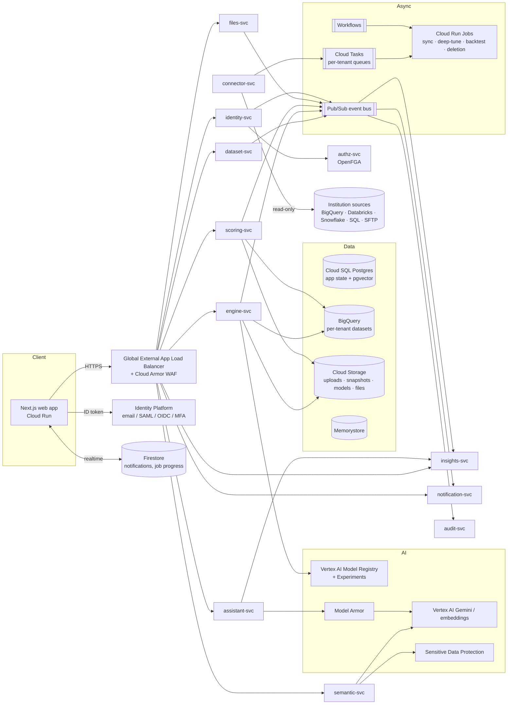
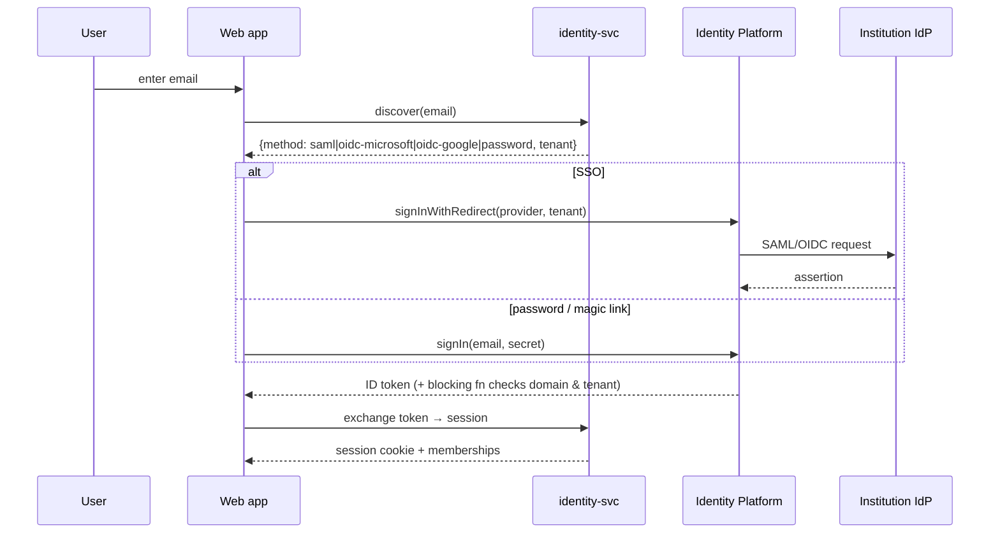

# YieldPilot — Production System Design (v1.0)

| | |
|---|---|
| Status | Proposed — for review before build |
| Scope | Multi-tenant SaaS that forecasts admission yield for any college, from that college's own data |
| Cloud | Google Cloud (GCP-native, US regions) |
| Runtime | Docker containers on Cloud Run (services + jobs) |
| Source & CI/CD | GitLab (monorepo, GitLab CI → Artifact Registry → Cloud Deploy) |
| Method | System Design Primer flow (requirements → high-level → core components → scale), Chip Huyen's ML-systems structure (setup → data → modeling → serving), Made-With-ML MLOps practices, and the GCP-architect / ML-engineer / RAG-architect / security skill checklists |
| Origin of the modeling recipe | `admission_yield_lab` (CSULB): XGBoost + Optuna + isotonic calibration + cycle shrinkage + department stabilization + post-waitlist deposit calibration |

> Prices, model names and regulatory dates in this document change often. Every one of them is marked *verify* and must be re-checked before a contract or budget relies on it. This document is engineering design, not legal advice.

---

## 1. Requirements, constraints and estimates

### 1.1 Who uses it and how
- **Institution users:** enrollment managers, admissions directors, institutional research analysts, deans, finance. Mostly non-ML users.
- **What they do:** connect data → confirm what each column means → set up a forecast (term, population) → see projected applicants→admits→enrolled→yield with a range → drill down to colleges, programs and individual admits → test scenarios → ask the AI assistant → generate and share reports.
- **YieldPilot staff:** support and ML engineers (break-glass, audited access only).

### 1.2 Functional requirements
1. Account creation by email; automatic detection and use of the institution's SSO (Microsoft Entra ID, Google Workspace, Okta, Shibboleth/InCommon SAML, any OIDC/SAML IdP); password, magic-link or SSO.
2. Institution account with RBAC: an Owner creates the institution, Admins invite users or approve join requests, roles control every action; notifications drive approvals.
3. Data from many sources: CSV/Excel upload, BigQuery, Databricks, Snowflake, Postgres/SQL Server/Oracle/MySQL, Slate, Banner/PeopleSoft/Colleague extracts, SFTP, GCS/S3.
4. **One engine**: the same recipe builds a fresh, school-specific model for every forecast, adapted to the school's columns, data size and quality; versions kept per school.
5. **Accurate from the first forecast** (not "learns later"), with an honest range and confidence label.
6. **Results in seconds**, not minutes. Heavy tuning happens in the background and silently upgrades the forecast if it is better.
7. LLM + data understanding: map columns by reading headers **and** values; recommend features based on the data and the model.
8. Preset dashboards **plus** automatically generated, data-specific KPIs and charts.
9. AI chat grounded in the institution's own data (RAG over structured data + documents), able to explain charts and generate files.
10. Files: reports, exports and yields files, with in-app sharing governed by permissions.
11. Notifications (in-app real time + email) for invitations, join requests, approvals, shares, forecast changes, sync failures, drift.
12. Full audit trail, data retention and deletion, and compliance evidence for FERPA, GLBA, SOC 2, HECVAT and accessibility.

### 1.3 Non-functional requirements (targets)
| Area | Target |
|---|---|
| Instant forecast (data already loaded) | p95 ≤ 20 s end-to-end; first numbers (browser preview) < 1 s |
| Feature toggle → refreshed forecast | p95 ≤ 10 s |
| What-if scenario | p95 ≤ 1.5 s |
| Dashboard / API reads | p95 ≤ 300 ms |
| AI chat first token | p95 ≤ 3 s |
| Availability (customer-facing APIs) | 99.9% monthly (error budget 43 min) |
| Data durability | RPO ≤ 15 min, RTO ≤ 4 h |
| Isolation | No cross-tenant read path exists; tested in CI on every merge |
| Security baseline | OWASP ASVS L2, CIS GCP benchmark, SOC 2 Type II controls |
| Accessibility | WCAG 2.1 AA |

### 1.4 Back-of-the-envelope (3-year horizon)
- Institutions: 200. Users: about 20 per institution, so about 4,000 total. Peak about 40 requests per second.
- Applicant rows: 30k per year × 10 years ≈ 300k rows per institution × 200 ≈ **60M rows, under 100 GB** in BigQuery. This is small data.
- Instant trainings: about 200 per institution per month, so 40k per month. At about 10 s on 8 vCPU each, that is **about 110 vCPU-hours per month**, which is trivial.
- Deep tuning jobs: about 20 per institution per month × about 10 min on 8 vCPU ≈ 5,300 vCPU-hours per month. Batch, Spot-like economics via Cloud Run Jobs.
- Model artifacts: 1–20 MB each × about 50 kept versions per institution ≈ under 200 GB.
- **Conclusion:** the system is bound by correctness, security and latency, not throughput. Serverless (Cloud Run, BigQuery) fits.

---

## 2. High-level architecture



### Architecture principles
1. **One engine, many models.** A fixed, versioned recipe is applied to each tenant's data. There is no shared student-level model across tenants.
2. **Precompute and speculate.** Training starts the moment the data and mapping exist, so results are ready before the user reaches the Results step.
3. **Database per service (logical).** Each service owns its schema and talks to others only through APIs and events.
4. **Asynchronous by default** for anything over 1 s. Synchronous calls only for reads and instant actions.
5. **Least data.** Copy only the mapped columns, pseudonymize IDs, and never send student-level records to an LLM.
6. **Everything as code.** Terraform for infrastructure, GitLab CI for delivery, ADRs for decisions.
7. **Defense in depth for tenancy:** token claims → authz checks → row-level security in Postgres and BigQuery → per-tenant encryption keys → VPC Service Controls perimeter.

---

## 3. User flows

### A. Sign up / sign in (email-first, SSO-aware)
1. User enters an email.
2. **Home-realm discovery** (`identity-svc /v1/auth/discover`):
   1. Domain is a verified institution domain with SSO configured → redirect to that institution's IdP (SAML/OIDC tenant in Identity Platform).
   2. Otherwise, detect the email provider:
      - **Microsoft:** the domain resolves as an Entra tenant (OIDC discovery `login.microsoftonline.com/{domain}/v2.0/.well-known/openid-configuration` returns 200) → "Continue with Microsoft" (multi-tenant OIDC app).
      - **Google Workspace:** MX records point to Google → "Continue with Google".
   3. Otherwise → email + password (breached-password check, strength rules) or email magic link.
3. Email must be verified. MFA (TOTP) is required for Owners and Admins and enforceable per institution.
4. After sign-in:
   - The domain matches an existing institution → **request to join**. Admins are notified and approve with a role.
   - Otherwise → **create institution**. Domain ownership is verified by a DNS TXT record (or manual review for a first pilot), and the creator becomes Owner.
   - The user arrived via an invitation link → joins with the invited role directly.
5. Sessions: the Identity Platform ID token is exchanged for a short-lived session (15 min access + rotating refresh, httpOnly SameSite cookies, CSRF token). Idle timeout and "sign out everywhere" are supported.



### B. Connect data
1. An Admin or Data Manager picks a connector (upload, BigQuery, Databricks, …) and enters credentials, which are stored only in Secret Manager.
2. `connector-svc` tests read-only access. The user picks tables or writes a query (validated as read-only).
3. A sync job extracts **only the columns needed**, scans for PII (Sensitive Data Protection), pseudonymizes IDs, and writes an immutable **dataset version** to the tenant's BigQuery dataset.
4. Profiling runs automatically (per-column statistics).

### C. Understand columns (LLM + rules)
1. `semantic-svc` proposes a meaning for every column (for example "HS GPA", "admit term", "aid offered") with a confidence score and a reason, based on header **and** values (§6).
2. The user reviews; high-confidence mappings are pre-confirmed. Confirmed mappings are remembered for the next sync.
3. **Speculative training starts now** in the background with the recommended features and default terms.

### D. Create a forecast → results in seconds
1. User picks term, population (First-Time Freshman, Transfer, or institution-defined) and checkpoint (applications close, admit release, May 1, …). Training terms are pre-selected: the two most recent comparable terms, marked Recommended.
2. Features: the engine's picks are shown with the evidence for each. The user can include or exclude.
3. Run: if the speculative model already matches this spec, results appear **instantly**. Otherwise an instant training runs (p95 ≤ 20 s), with live progress.
4. Results: Applications, Admits, Enrolled (projected) with a range, Yield %, confidence, charts, admit-level list.
5. In the background, deep tuning and the full backtest run. If the challenger is measurably better, the forecast updates and the user gets a notification ("Forecast refined: 5,347 → 5,362, range narrowed").

### E. Explore
Dashboard (preset + auto-generated charts), admit-level view with reasons, what-if scenarios (rescored live with the real model), trend, funnel.

### F. Ask the assistant, explain, generate files
Chat answers come from governed queries and documents, with citations. "Explain this chart" works on any chart. "Create a board-ready PDF of the Fall forecast" produces a file in Files.

### G. Share and collaborate
Share a file or report with users, roles or groups inside the institution. Recipients are notified, and access is checked on every open. Student-level exports need the `export_student_level` permission and are watermarked and audited.

### H. In-cycle updates
Nightly sync of admit status, waitlist, deposits and enrollment-to-date → rescore with the production model (seconds) → tracking vs forecast → alerts when the projection moves more than a threshold.

### I. Administration
Users, roles, SSO setup, SCIM, connectors, data retention, deletion requests, audit log viewer, billing.

---

## 4. Identity, access and approvals

### 4.1 Components
- **Identity Platform** (GCP): multi-tenancy (one tenant per institution), email/password, email link, SAML and OIDC providers per tenant, TOTP and SMS MFA, blocking functions (`beforeCreate` / `beforeSignIn`) to enforce domain rules and institution assignment, and reCAPTCHA Enterprise against bot sign-ups.
- **identity-svc:** institutions, verified domains, memberships, invitations, join requests, role assignments, home-realm discovery, session exchange, SCIM 2.0 endpoint (`/scim/v2/Users`, `/Groups`) for enterprise auto-provisioning and deprovisioning.
- **authz-svc (OpenFGA):** relationship-based permissions for fine-grained sharing (files, reports, forecasts) layered on top of roles. Every service calls `check(user, relation, object)`; results are cached for 30 s in Memorystore.

### 4.2 Roles (institution-scoped)
| Permission | Owner | Admin | Data Manager | Analyst | Viewer |
|---|:-:|:-:|:-:|:-:|:-:|
| Billing, delete institution | ✓ | | | | |
| SSO, SCIM, domains | ✓ | ✓ | | | |
| Invite/approve users, assign roles (≤ own role) | ✓ | ✓ | | | |
| Connectors & data sync | ✓ | ✓ | ✓ | | |
| Confirm mappings, run audits/fixes | ✓ | ✓ | ✓ | | |
| Create/run forecasts, scenarios | ✓ | ✓ | ✓ | ✓ | |
| Promote a model to Production | ✓ | ✓ | ✓¹ | | |
| View aggregates & dashboards, use chat | ✓ | ✓ | ✓ | ✓ | ✓ |
| View admit-level rows (pseudonymous) | ✓ | ✓ | ✓ | ✓ | |
| Export with real student IDs | ✓ | ✓ | ✓² | ✓² | |
| Share files | ✓ | ✓ | ✓ | ✓ | view-only |
| Audit log | ✓ | ✓ | | | |

¹ Optional two-person rule: a second Admin approves. ² Off by default; enabled per user by an Admin.

### 4.3 Approval workflows
Join requests, role elevation, model promotion (optional two-person rule), first student-level export (optional), and connector creation (optional). Each is a state machine in `identity-svc`: `pending → approved | rejected | expired`. It emits events, and `notification-svc` delivers them.

---

## 5. Data platform

### 5.1 Copy or read in place?
**Decision:** read from the source, then keep a **minimal, pseudonymized, versioned snapshot** in the tenant's own BigQuery dataset.

| Need | Why a snapshot is required |
|---|---|
| Results in seconds | Training reads from BigQuery Storage Read API (Arrow) in about 1–2 s; querying a remote Databricks/Snowflake warehouse each time is too slow and costs the customer compute |
| Reproducible and auditable models | Every model version must be rebuildable from the exact data it saw (FERPA/SOC 2 evidence, disputes) |
| Point-in-time correctness | Checkpoint forecasts need the data as of that date; live sources change underneath |
| Reliability | Forecasts must work when the customer's warehouse is down |

**What is copied:** only mapped columns, only the needed populations and terms. Student IDs are replaced by a keyed hash (HMAC with a per-tenant key in Cloud KMS). Names, emails, phones, addresses, SSNs and dates of birth are never stored; they are blocked at ingest.

**Zero-copy options** for strict customers:
- **BigQuery customers:** Analytics Hub linked dataset or authorized views. Data stays in their project; we read at training time and persist only features, models and aggregates.
- **Databricks:** Delta Sharing. **Snowflake:** secure data sharing.
- **Enterprise later:** "in-your-cloud" deployment of the engine (Cloud Run + their BigQuery) or BigQuery ML boosted trees run inside their project.

### 5.2 Ingestion pipeline (connector-svc + sync job)
`extract (read-only)` → `quarantine bucket` → `malware scan + file-type check` → `Sensitive Data Protection inspect` (block or drop PII) → `pseudonymize IDs` → `schema + data contract validation (Pandera)` → `write dataset version (BigQuery table + Parquet copy in GCS)` → `profile` → event `dataset.version.created`.

### 5.3 Storage layout
| Store | Contents | Isolation |
|---|---|---|
| BigQuery `t_<tenant>` dataset | `raw_v<N>`, `features_v<N>`, `predictions`, `status_snapshots`, `aggregates` | Dataset per tenant, CMEK per tenant, row-level and column-level security, authorized views for the assistant |
| Cloud Storage | `uploads/` (quarantine), `snapshots/`, `models/`, `files/` | Prefix per tenant, CMEK per tenant, uniform bucket-level access, object versioning |
| Cloud SQL (Postgres 16, HA) | App state per service schema; pgvector for document RAG | Row-level security on `tenant_id`, IAM DB auth, private IP only |
| Firestore | Notification inbox and job progress (no student data) | Security rules keyed on the Identity Platform tenant and user |
| Memorystore | Cache, rate limits, idempotency keys | No student data |

### 5.4 Data versioning and edits
Every upload, sync, UI edit (delete rows or columns, cell edit) and audit fix creates a new **immutable** dataset version with a parent pointer (copy-on-write). Undo means pointing back to the parent. Retention is configurable per tenant, with a default of the last 20 versions plus every version used by a Production model.

---

## 6. Column understanding and feature recommendation

### 6.1 Canonical feature ontology
A versioned dictionary of about 60 standard concepts in groups:
- **Identity and outcome:** student key, term, admit status, enrolled, deposited.
- **Academic:** HS GPA, subject GPAs, test scores, class rank.
- **Application:** application date, round/plan, days to apply, waitlist flag, admit date.
- **Program:** college, department, major/plan.
- **Geography:** ZIP, state, country, residency, distance.
- **Finance:** aid offered, net cost, merit/need indicators.
- **Engagement:** visits, events, interviews, email/portal activity.
- **Population:** student type, entry level.
- **Restricted:** protected attributes and FAFSA-derived fields.

Each concept carries:
- a description and synonyms
- an expected type and value pattern
- valid ranges
- a **time-of-knowledge** label (known before applications close, after admit, or after decision)
- a **policy class**: usable, restricted (FAFSA), protected (audit only), forbidden (direct PII)
- a domain prior for usefulness

### 6.2 Mapping pipeline (semantic-svc)
1. **Profile** each column: data type, distinct count, null share, min/max, regex pattern hits (term codes, ZIPs, dates, GPA scale), entropy, and top values.
2. **Mask values** with Sensitive Data Protection before anything leaves the data plane. The LLM never sees names or IDs.
3. **Deterministic matchers:** known header synonyms, value validators (GPA ∈ [0, 5]; ZIP pattern; term-code grammars for PeopleSoft `2264`, Banner `202510`, "Fall 2025").
4. **Embedding similarity:** the header plus a profile summary, matched against ontology descriptions (Vertex AI text embeddings).
5. **LLM adjudication** for ambiguous columns: Gemini on Vertex AI with structured JSON output. The input is the header, the profile, masked sample values and the top-k ontology candidates. The output is `{concept, confidence, reason, transform}`, for example `"Y/N → boolean"` or `"cents → dollars"`.
6. **Combine:** a weighted vote across matchers gives the final confidence. Columns at 0.9 or above are pre-confirmed; columns below 0.6 are flagged for the user.
7. **Memory:** confirmed mappings are stored per tenant and reused on the next sync. Global synonym statistics (header text only, no values) improve deterministic matchers over time.
8. **Quality bar:** mapping accuracy is evaluated on a golden set (CSULB columns plus synthetic variants of 30+ SIS/CRM exports). The target is top-1 accuracy of 95% or higher on standard concepts before release.

### 6.3 Feature recommendation
Evidence comes from the data and the model, not just the LLM:
- **Relevance:** point-biserial or eta per feature on closed terms.
- **Stability:** importance computed on each past term separately; consistent contributors rank higher.
- **Ablation:** the backtest gain from adding or removing each feature group.
- **Policy and leakage filters:** time-of-knowledge after the checkpoint is excluded; near-perfect predictors (relevance > 0.85) are excluded; IDs and free text are excluded; protected and restricted attributes are excluded by default.
- **Explanation:** the LLM writes the one-line reason shown in the UI, from those computed numbers only.

---

## 7. The Yield Engine — one engine, a fresh model per school

### 7.1 Model identity and versions
A **model spec** is defined by:
- dataset version
- confirmed mapping
- population
- checkpoint
- target term
- training terms
- features
- recipe version
- tier

`spec_hash = sha256(spec)`. Identical spec → reuse the model instantly. Any change → new training.

**Lineage per tenant:** `tenant / population / checkpoint → versions v1, v2, …`, with the alias `production` (set by a human, as in the lab), plus `champion` and `challenger` tags. Artifacts live in GCS and are registered in **Vertex AI Model Registry** (versions, aliases, labels). Metrics and parameters go to **Vertex AI Experiments**. A **model card** (JSON + PDF) is generated for every version.

**Recipe versions** (our improvements) never auto-replace a school's production model. A challenger is trained per school and promoted only if it wins that school's backtest.

### 7.2 The recipe (fixed steps, automatic knobs)
| Step | What happens | Automatic knob |
|---|---|---|
| 1 Build frame | Filter population; admits-only for training; target = enrolled at census; feature values as of the checkpoint | — |
| 2 Engineer features | Year offset, season, days-to-apply (tenant calendar), distance and ZIP income (Census ACS + ZCTA), tenant index formulas, top-N program grouping + OTHER, rule buckets, missing flags | Which transforms apply depends on the mapped concepts |
| 3 Guard | Remove leakage, IDs, protected/restricted/forbidden concepts | — |
| 4 Select features | Stability-based selection on time folds, correlation clustering, cap by data size | Count and selection |
| 5 Choose window | Last k comparable terms × recency decay (lab: `exp(-0.15·years)`) | k and decay by backtest |
| 6 Fit | Tier A/B: gradient-boosted trees (XGBoost/LightGBM hist). Tier C: regularized logistic or shallow CatBoost | Model family by tier; hyperparameters warm-started (§7.4) |
| 7 Calibrate | Isotonic (n ≥ 2,000) or sigmoid, cross-fitted | Method by size and backtest |
| 8 Aggregate anchoring | Blend the student-level sum with a top-down per-college time-series forecast (lab's cycle shrinkage generalized) | Blend weight α by backtest |
| 9 Stabilize | Department/program adjustment within a Wilson band (lab) | Band and tolerance |
| 10 Uncertainty | Poisson-binomial variance + conformal error from backtests → range | — |
| 11 Gate | Must beat naive (last yield × admits) on backtest; calibration error limit; no leakage flags; fairness checks | Otherwise fall back to a simpler model or naive + explanation |
| 12 Explain | TreeSHAP global and per-student top factors; model card; fairness report on protected attributes (audit only) | — |

**Data tiers** (set automatically by profiling):

| Tier | Data | Family | Tuning |
|---|---|---|---|
| A | 3+ closed comparable terms, 5k+ admits/term | GBM; ensemble allowed | Deep (background) |
| B | 2+ terms, 1–5k admits | GBM or regularized logistic, whichever wins | Medium |
| C | 1–2 terms or under 1k admits | Regularized logistic, shallow CatBoost | Light |
| D | No closed outcomes | No student model: IPEDS-based institutional estimate plus deposit tracking | — |

### 7.3 Accurate from the first forecast
The lab's deployed v3 missed Fall 2026 by +18.7%, because it learned from an older, higher-yield era. The recent-window recipe missed by −0.9%. The engine builds that lesson in so a first forecast does not "go off a lot":
1. **Window chosen by backtest,** not by habit. If yield is trending, recent terms win automatically.
2. **Bottom-up plus top-down blend:** the student model's sum is blended with each college's own time-series forecast. A single bad level estimate can't run away.
3. **Bias correction:** systematic over- or under-prediction seen in backtests is corrected at the aggregate level.
4. **Plausibility guardrail:** a projected yield outside the school's historical band is flagged and shrunk unless the admit mix explains it (for example, many more early-action admits).
5. **Calibration** so probabilities add up to the right total.
6. **In-cycle convergence:** as deposits arrive, the deposit-anchored factor `deposits × (1 − historical melt) / Σp` (lab Point B) pulls the projection onto observed reality.
7. **Proof before purchase:** the onboarding "backtest report" shows each prospect how close the engine would have been on their last 3 terms. This is a sales asset and a go/no-go check.
8. **Honest range and confidence** on every number, and a refusal mode when data can't support a forecast.

**Targets** (measured on backtests, published per tier, never promised as contractual accuracy):
- Tier A: aggregate error ≤ 3%
- Tier B: ≤ 6%
- Tier C: ≤ 10%

### 7.4 Results in seconds (how)
| Technique | Effect |
|---|---|
| **Speculative training** when mapping is confirmed and on every new sync | The model is usually ready before the user asks |
| **Spec-hash cache** | Re-asking the same thing is instant |
| **Cached encoded matrices** (Arrow/Parquet per dataset version + feature set) | No re-reading or re-encoding |
| **Warm-started hyperparameters** (previous champion for this school → the tier's defaults learned on public/synthetic benchmarks → lab v3 values) | No search at request time |
| **Early stopping** on the latest training term | Trees stop at the useful count |
| **Parallel cross-fitted calibration + one-fold backtest** on an 8-vCPU Cloud Run instance | About 1 fit of wall time |
| **Browser preview** (existing in-browser logistic model) | Numbers on screen in under 1 s while the server finishes |
| **Background deep tuning** (Optuna TPE, seeded, multi-objective: log loss + class-size error, pruning; full multi-term backtest) on Cloud Run Jobs | Better model arrives later as a challenger; auto-swapped only if it wins; user notified |

**Expected timings** (40–120k rows, ~30 features, 8 vCPU; to be benchmarked in Phase 1):

| Step | Time |
|---|---|
| Load | 1–2 s |
| Encode (cached) | 0 s, otherwise ~1 s |
| Fit | 3–8 s |
| Calibrate + backtest (parallel) | 3–6 s |
| SHAP + score | 1–3 s |
| **Total** | **≈ 8–20 s** |

### 7.5 Serving and maintenance of models
- **Where models live:** GCS artifacts, registered in Vertex AI Model Registry. There are no always-on per-model endpoints, which would be too costly across many tenants.
- **Serving:** `scoring-svc` (Cloud Run, min 1 instance) loads models on demand into an in-memory LRU cache (models are MB-sized). Batch scoring writes predictions to BigQuery; what-if requests are scored live.
- **Monitoring:**
  - nightly drift (PSI on features, prediction distribution)
  - live calibration vs deposits and enrollment-to-date
  - post-census evaluation of every production model
  - alerts via `notification-svc`
- **Retraining triggers:** new dataset version, mapping or feature change, term closes, drift above threshold, recipe upgrade (as challenger). Daily in-cycle updates **rescore**; they do not retrain.

### 7.6 Engine package layout (`libs/yield-engine`)
`profiling/ · ontology/ · features/ · guards/ · selection/ · windows/ · models/ (gbm, logistic, catboost) · calibration/ · anchoring/ (cycle shrinkage, top-down blend, dept stabilization, deposit calibration) · uncertainty/ · backtest/ · explain/ · cards/ · recipe.py (versioned)`

Each module is ported and generalized from the lab (`training.py`, `cycle_shrinkage.py`, `stabilize_dept.py`, `rescore_postwl.py`, `scoring.py`), with unit tests and golden-data regression tests.

---

## 8. Insights: preset and automatic KPIs and charts

### 8.1 Semantic layer
`insights-svc` defines governed metrics once (applications, admits, admit rate, projected enrolled, yield %, prior-year yield, melt, deposit rate, …) and governed dimensions (term, college, program, residency, region, segment, …). Requests compile to parameterized BigQuery SQL through tenant-scoped authorized views. Free-form SQL never reaches the database.

### 8.2 Preset dashboards
KPI cards, yield trend, funnel, yield by college, probability distribution, drivers, admits by likelihood, in-cycle tracking.

### 8.3 Auto-generated insights
1. **Candidate generation:** rules over the mapped concepts. Dimension × metric → bar; time × metric → line; numeric → distribution; dimension × dimension → heatmap; funnel stages → funnel.
2. **Scoring:** "interestingness" from effect size across groups, change vs prior term, anomaly score, coverage and stability; small-group suppression.
3. **Selection and narration:** the LLM chooses and names the top N and writes a one-sentence takeaway **from the computed result table only**. A validator checks every number in the text against the data and regenerates or drops the text on mismatch.
4. **Rendering:** each chart is a declarative **Vega-Lite** spec (schema-validated) rendered in the web app. Users can pin, edit or ask the assistant for new charts.
5. **Caching:** charts are recomputed on new dataset versions or forecasts and stored per tenant.

---

## 9. AI assistant (RAG over the institution's data)

### 9.1 Design
- **Runtime:** `assistant-svc` on Cloud Run, using Google's Agent Development Kit (ADK). Models are Gemini on Vertex AI: a fast tier for routing and extraction, a reasoning tier for answers. *Verify current model versions.* Claude on Vertex AI is a pluggable alternative behind the same provider interface.
- **Tools, all permission-checked as the calling user:**
  - `query_metric(metric, dims, filters, period)` → semantic layer → BigQuery
  - `get_forecast(id)`, `get_model_card(version)`, `explain_chart(chart_spec, data_summary)`
  - `search_docs(query)` → pgvector over model cards, data cards, data dictionary, reports, glossary and help (tenant-filtered)
  - `create_chart(spec_request)` → Vega-Lite spec
  - `generate_file(type, template, content)` → files-svc
  - `share_file(file, principals)`
- **Grounding:** every number comes from a tool result; answers cite their sources (metric query, document, chart).
- **Privacy:**
  - k-anonymity threshold (default 10) on any group returned to the LLM
  - student-level rows are never sent to the LLM
  - prompts and responses are retained 30 days for audit, then deleted
  - Vertex AI does not train on customer data (*verify current terms in the DPA*)
- **Safety:** Model Armor screens prompts and responses (prompt injection, sensitive data, unsafe content). The tool allowlist is per role. Write tools require confirmation.
- **Quality:** a curated evaluation set (100+ questions per persona) runs in CI on prompt or model changes, scoring groundedness, correctness of numbers and retrieval precision/recall (RAG-architect floors: precision@5 ≥ 0.8, recall@10 ≥ 0.85). Online thumbs-up/down feeds the next evaluation set.

### 9.2 File generation
Report templates (PDF via headless Chromium, DOCX, XLSX, PPTX) are filled from computed data and grounded narrative. They are saved into Files with permissions, a version and an audit entry.

---

## 10. Files and sharing (`files-svc`)
- Objects live in GCS (per-tenant CMEK); metadata, versions and folders in Cloud SQL.
- **Permissions** in OpenFGA: `owner`, `editor`, `viewer` on files and folders; principals are users, groups and roles. Inheritance runs folder → file.
- **Sharing:**
  - Share inside the institution, with a notification to recipients.
  - Optional expiring links that still require sign-in. No public links by default.
  - Downloads use short-lived signed URLs.
- **Student-level files:** Sensitive Data Protection scan, watermark (user, time), `export_student_level` permission and an audit entry.
- **Types:** reports, yields files (`ID|F|prob` with configurable marker), CSVs, chat-generated files, uploaded supporting documents (also indexed for RAG).

---

## 11. Notifications (`notification-svc`)
- **Sources:** Pub/Sub events. Examples: `membership.join_requested`, `invite.sent`, `approval.required`, `forecast.refined`, `forecast.changed_significantly`, `sync.failed`, `drift.detected`, `file.shared`, `export.completed`.
- **Channels:**
  - In-app: Firestore inbox, real-time in the web app
  - Email: transactional provider such as SendGrid/Postmark; no student data in emails
  - Optional: Slack/Teams webhooks
- **Preferences** per user (instant, daily digest, off), with **actionable notifications** ("Approve as Analyst", "Reject").

---

## 12. Service catalog (microservices on Cloud Run)

| Service | Responsibility | Owns (data) | Cloud Run profile |
|---|---|---|---|
| web | Next.js app (App Router): pages, route protection, security headers. No database access; all data via the APIs | — | 1 vCPU, min 1 (standalone Node build) |
| identity-svc | Institutions, domains, users, memberships, invites, join requests, approvals, HRD, sessions, SCIM | Cloud SQL `identity` | 1 vCPU, min 1 |
| authz-svc | OpenFGA permission checks | Cloud SQL `authz` | 1 vCPU, min 1, internal |
| connector-svc | Connections, sync schedules, extraction orchestration | Cloud SQL `connector` + Secret Manager | 1 vCPU; jobs for extraction |
| dataset-svc | Dataset versions, validation, PII handling, profiling, audits/fixes, edits | Cloud SQL `dataset` + BigQuery + GCS | 2 vCPU |
| semantic-svc | Ontology, column mapping, feature recommendation | Cloud SQL `semantic` | 2 vCPU |
| engine-svc | Model specs, instant training, registry integration, model cards | Cloud SQL `engine` + GCS + Vertex AI | 8 vCPU / 16–32 GiB, concurrency 1, min 1 |
| scoring-svc | Batch scoring, what-if, SHAP | — (model cache) | 4 vCPU, min 1 |
| insights-svc | Semantic layer, dashboards, auto insights | Cloud SQL `insights` + BigQuery | 2 vCPU, min 1 |
| assistant-svc | Agent, RAG, tools | Cloud SQL `assistant` (+ pgvector) | 2 vCPU, streaming |
| files-svc | Files, versions, sharing, report rendering | Cloud SQL `files` + GCS | 2 vCPU; render jobs |
| notification-svc | Inbox, email, preferences | Firestore + Cloud SQL `notify` | 1 vCPU |
| audit-svc | Audit events, retention, deletion sagas, evidence exports | BigQuery `audit` + locked log bucket | 1 vCPU |
| billing-svc | Plans, entitlements, Stripe webhooks | Cloud SQL `billing` | 1 vCPU |
| **Jobs** | `sync`, `deep-tune`, `backtest`, `rescore-nightly`, `drift`, `tenant-deletion` | — | Cloud Run Jobs, parallel tasks |

Each service has its own runtime service account, its own database user, an OpenAPI contract and an owner (CODEOWNERS).

---

## 13. Communication and reliability patterns
- **External:** the Global External Application Load Balancer routes `/api/<service>/v1/*` to serverless NEGs. Cloud Armor applies OWASP rules, rate limits per IP and per tenant, and bot protection.
- **Service-to-service:** private (internal ingress), authenticated with Google-signed ID tokens (Cloud Run IAM `roles/run.invoker` per caller), plus the end-user context propagated as a signed header.
- **Events:** Pub/Sub topics per domain in CloudEvents format, with JSON Schemas in `libs/contracts`. Each subscription has a dead-letter topic and retry policy. Writes and their events are made atomic with the **transactional outbox** pattern.
- **Work queues:** Cloud Tasks queues per workload with per-tenant concurrency caps, so a noisy tenant can't starve others.
- **Orchestration:** Workflows for multi-step jobs (deep-tune → backtest → register → compare → notify; tenant deletion saga).
- **Resilience:**
  - idempotency keys on every mutating API
  - timeouts on all calls
  - retries with exponential backoff and jitter
  - circuit breakers around external connectors and LLM calls
  - graceful degradation: browser preview and cached results when the engine is busy; the assistant falls back to a "can't answer now" state
- **Consistency:** strong within a service (Postgres transactions); eventual across services (events). UI reads show "updating…" states driven by Firestore job progress.

---

## 14. GCP infrastructure

### 14.1 Resource hierarchy (Google enterprise foundations blueprint, Terraform)
- **Organization:** `yieldpilot.com` with Org Policies:
  - US-only resource locations
  - no service account keys
  - uniform bucket access
  - no public IPs on services
  - domain-restricted sharing
  - CMEK required on data services
- **Folders:** `bootstrap`, `common` (logging, security, artifacts, CI), `production`, `staging`, `development`.
- **Projects per environment:** `app` (Cloud Run services), `data` (BigQuery, GCS, Cloud SQL), `ml` (Vertex AI, jobs), `net` (Shared VPC host).
- **Shared projects:** `logging` (locked log buckets), `security` (Security Command Center, KMS admin), `artifacts` (Artifact Registry), `cicd` (Workload Identity Federation for GitLab).

### 14.2 Networking
- Shared VPC with private subnets; Cloud Run uses Direct VPC egress.
- Private Service Connect / Private Google Access to Google APIs.
- Cloud SQL on private IP only.
- Cloud NAT with **static egress IPs**, so institutions can allowlist us.
- Connectivity to institution databases via VPN / Interconnect partner, SSH bastion (IAP), or the vendor's private links.
- **VPC Service Controls** perimeter around BigQuery, Cloud Storage, Vertex AI, Cloud SQL, Secret Manager and KMS (data-exfiltration protection). Access levels only for CI and break-glass.

### 14.3 Environments
`dev` (shared, synthetic data only), `staging` (production-like, synthetic and consented pilot data), `prod`. Production data never leaves prod.

---

## 15. Security architecture
| Layer | Controls |
|---|---|
| Edge | Cloud Armor WAF (OWASP CRS), adaptive protection, rate limits, reCAPTCHA Enterprise on auth, HSTS, strict CSP, SRI |
| Identity | SSO (SAML/OIDC), MFA for privileged roles, SCIM deprovisioning, session hardening, anomaly alerts on sign-ins |
| Authorization | Roles + OpenFGA relationships; Postgres and BigQuery row-level security; cross-tenant negative tests in CI |
| Data | CMEK per tenant (Cloud KMS; Cloud HSM optional), TLS 1.2+ everywhere, pseudonymized IDs, PII blocked at ingest, k-anonymity in aggregates sent to LLMs, crypto-shredding on deletion |
| Workloads | Distroless or minimal non-root images, read-only filesystems, Binary Authorization (only signed images from our CI), per-service least-privilege service accounts, no keys (Workload Identity Federation) |
| Secrets | Secret Manager with rotation; nothing in images, repos or env files |
| Supply chain | SBOM (Syft), image signing (cosign), Artifact Registry vulnerability scanning, dependency pinning and Renovate, SLSA level 3 target |
| Detection | Cloud Audit Logs (admin + data access) to locked buckets, Security Command Center, Event Threat Detection, alerting to on-call; Access Transparency for Google staff access |
| AI | Model Armor, tool allowlists, no training on customer data, prompt/response logging with retention, evaluation gates |
| Resilience | Cloud SQL HA + PITR, cross-region backups, BigQuery time travel + snapshots, GCS versioning + dual-region for artifacts, quarterly DR drills |
| AppSec process | Threat model (STRIDE) per service, security review in MR template, SAST/DAST, annual third-party pen test plus after major releases, bug bounty after GA |

---

## 16. Compliance and legal program (engineering view; counsel must confirm)

| Obligation | How the system and program meet it |
|---|---|
| **FERPA** (school official exception) | DPA limits use to the institution's purpose; no redisclosure; access logging; deletion at contract end with certificate; data minimization |
| **GLBA / FTC Safeguards Rule** (student financial-aid data) | Written information security program, named qualified individual, risk assessment, MFA, encryption, pen testing, incident response, annual board report |
| **FAFSA data restrictions** (HEA §483) | FAFSA-derived fields are policy class *restricted*: off by default, enabled only after the institution attests counsel approval |
| **Civil rights, SFFA, state bans** (e.g., CA Prop 209) | Protected attributes excluded from models by default; used only in fairness audits; proxy monitoring (e.g., ZIP income) |
| **State AI laws** (e.g., Colorado AI Act, *verify effective date*) | Model cards, impact assessment template, intended-use statement, human review, notices; product is for planning and outreach, **not** admission or aid decisions (in Terms) |
| **State privacy and breach laws** | Processor terms, breach playbook with notification timelines, records of processing |
| **Accessibility** (ADA Title II, Section 508) | WCAG 2.1 AA, automated axe checks in CI, manual audits, VPAT |
| **Attestations buyers request** | SOC 2 Type I → Type II (compliance automation tool such as Vanta or Drata), HECVAT Full, later ISO 27001/42001; TX-RAMP/GovRAMP for states that require it |
| **Contracts** | MSA, DPA, security addendum, SLA (uptime and support, not accuracy), privacy policy, subprocessor list (GCP, email provider, Stripe, GitLab), acceptable-use and AI policy |
| **Company protections** | Cyber liability + tech E&O insurance; incorporated entity; education-privacy counsel on retainer |

---

## 17. Technology stack

| Layer | Choice |
|---|---|
| Frontend | Next.js (App Router, standalone output on Cloud Run) + React + TypeScript, TanStack Query, Zod, Tailwind + Radix/shadcn, Recharts (presets) + Vega-Lite (generated charts), Firebase JS SDK (Identity Platform auth, Firestore listeners), OpenAPI-generated client (orval), Vitest, Playwright, axe |
| Backend services | Python 3.12, FastAPI, Pydantic v2, SQLAlchemy 2 (async) + Alembic, uv, httpx, tenacity, structlog, OpenTelemetry |
| Data processing | BigQuery (Storage Read/Write APIs), Polars, DuckDB, PyArrow, Pandera (data contracts) |
| ML | scikit-learn, XGBoost, LightGBM, CatBoost, Optuna, SHAP, statsmodels, MAPIE (conformal), Evidently (drift reports), Vertex AI SDK (Model Registry, Experiments) |
| LLM | Vertex AI Gemini (fast + reasoning tiers; *verify versions*), Vertex AI text embeddings, Google ADK, Model Armor, pgvector, Vertex AI Gen AI evaluation |
| Identity and permissions | Identity Platform, OpenFGA |
| Messaging and orchestration | Pub/Sub, Cloud Tasks, Workflows, Cloud Scheduler, Eventarc |
| Data stores | Cloud SQL for PostgreSQL (Enterprise Plus HA), BigQuery, Cloud Storage, Firestore, Memorystore |
| Security | Cloud Armor, VPC Service Controls, Cloud KMS, Secret Manager, Sensitive Data Protection, Security Command Center, Binary Authorization, reCAPTCHA Enterprise |
| Delivery | Docker (multi-stage, distroless), GitLab CI, Artifact Registry, Cloud Deploy (canary), Terraform (Google foundations modules), Renovate, cosign, Syft |
| Observability | Cloud Logging, Monitoring, Trace, Error Reporting (OpenTelemetry), uptime checks, SLO dashboards |
| Third-party | Email: SendGrid or Postmark. Billing: Stripe. Feature flags: OpenFeature + Unleash (self-hosted). Status page. |

---

## 18. Repository and engineering standards (GitLab)

### 18.1 Monorepo layout
```
yieldpilot/
├─ apps/web/                       # Next.js app (current YieldPilot UI ported to App Router)
├─ services/<name>/                # one folder per microservice (src/, tests/, Dockerfile, openapi.yaml)
├─ jobs/{sync,deep-tune,backtest,rescore,drift,tenant-deletion}/
├─ libs/
│  ├─ yield-engine/                # the ML engine (from admission_yield_lab, generalized)
│  ├─ ontology/                    # canonical feature dictionary + policies
│  ├─ py-common/                   # auth middleware, tenancy context, errors, otel, pagination, outbox
│  └─ contracts/                   # OpenAPI + event JSON Schemas + generated clients
├─ infra/terraform/{org,projects,network,security,data,services}/
├─ deploy/                         # Cloud Deploy pipelines, Skaffold, service.yaml per service
├─ docs/{adr,runbooks,security,compliance,model-cards}/
└─ .gitlab-ci.yml  ci/templates/
```

### 18.2 Containers (Docker)
Multi-stage builds, pinned base digests, distroless or slim Python, non-root UID, no shell in production images, `uv sync --frozen`, health/startup probes, one process per container, `PORT` from env.

### 18.3 GitLab CI/CD pipeline

```mermaid
flowchart LR
  A[MR opened] --> B[detect changed paths]
  B --> C[lint + typecheck<br/>ruff · pyright · eslint · tsc]
  C --> D[unit tests<br/>pytest · vitest]
  D --> E[integration tests<br/>Testcontainers · emulators]
  E --> F[ML gates<br/>golden datasets · backtest thresholds]
  F --> G[security<br/>SAST · secrets · deps · IaC · container scan]
  G --> H[build image + SBOM + cosign sign]
  H --> I[push Artifact Registry<br/>via Workload Identity Federation]
  I --> J[Cloud Deploy: dev]
  J --> K[staging: DAST + e2e + a11y]
  K --> L{approval}
  L --> M[prod canary 10% → 50% → 100%<br/>auto-rollback on SLO breach]
```

- Protected `main`, required approvals (CODEOWNERS), signed commits, merge trains.
- Separate infrastructure pipeline: `terraform plan` on MR, `apply` after approval.
- No long-lived GCP keys: GitLab OIDC `id_tokens` → Workload Identity Federation → per-environment deployer service accounts.
- Releases: semantic versioning per service, changelogs, feature flags for risky changes, expand/contract database migrations.

### 18.4 Testing strategy
Unit → contract tests (Pact, between services) → integration (real Postgres, Pub/Sub/Firestore emulators, BigQuery sandbox) → end-to-end (Playwright against staging) → ML tests (data contracts, recipe regression on golden datasets, leakage tests, fairness tests) → load tests (k6) before each major release → chaos drills (dependency failure) quarterly.

### 18.5 Ways of working
ADRs for every significant decision, RFCs for cross-service changes, definition of done (tests, docs, threat-model delta, dashboards, runbook), on-call rotation with runbooks, blameless postmortems.

---

## 19. Observability and SLOs
- OpenTelemetry tracing across services with `tenant_id`, `request_id` and `spec_hash` attributes. **No PII** in logs or traces; there is a log scrubbing filter.
- **SLOs:** API availability 99.9%, instant-forecast p95 ≤ 20 s, what-if p95 ≤ 1.5 s, chat first token p95 ≤ 3 s, nightly rescore complete by 07:00 local.
- **ML health:** drift (PSI), calibration error, backtest error per tenant, champion vs challenger, post-census error.
- **LLM health:** groundedness score, tool error rate, Model Armor blocks, cost per tenant.

---

## 20. Cost (rough, *verify with the GCP pricing calculator*)
Early production (first 10–30 institutions), per month:

| Item | Estimate |
|---|---|
| Cloud SQL HA | $400–800 |
| Cloud Run min instances | $250–500 |
| Load balancer + Cloud Armor | $50–150 |
| Memorystore | $50–150 |
| BigQuery | < $200 |
| Logging/monitoring | $100–300 |
| KMS / Secret Manager / Firestore | < $100 |
| Vertex AI LLM usage | usage-based; budget per tenant with alerts |
| Security Command Center tier | per pricing |
| Staging | about 30–40% of production |

Engine compute per forecast is cents. Scale costs grow mainly with LLM usage and Cloud SQL size.

---

## 21. Delivery roadmap (2–4 engineers)
| Phase | Weeks | Scope |
|---|---|---|
| 0 Foundations | 1–3 | GitLab monorepo, ADRs, GCP org + Terraform foundations, CI/CD with security gates, Identity Platform + identity-svc (email-first login, HRD, invites, roles), authz-svc |
| 1 Core forecast | 4–9 | dataset-svc (upload, versions, PII, profiling), semantic-svc (rules + embeddings + LLM mapping), yield-engine (lab recipe generalized, tiers B/C), engine-svc (instant training, cache, registry), scoring-svc, insights presets, frontend wired to APIs |
| 2 Accuracy and depth | 10–14 | Deep tuning jobs, full backtests, anchoring blend, uncertainty, gates, model cards, onboarding backtest report, connectors (BigQuery, Databricks, Snowflake, SQL, SFTP), auto insights |
| 3 AI and collaboration | 15–19 | assistant-svc (ADK, tools, RAG, Model Armor, eval set), files-svc (reports, sharing), notification-svc (inbox, email, approvals), audit-svc |
| 4 In-cycle and compliance | 20–26 | Nightly sync + rescore, deposit calibration, drift, SCIM, retention/deletion sagas, SOC 2 Type I, HECVAT, WCAG audit, pen test, pilot institution under DPA |
| 5 GA | 27+ | SOC 2 Type II window, billing, status page, enterprise zero-copy options |

---

## 22. Key risks and open decisions
| Risk / decision | Mitigation / owner |
|---|---|
| Legal use of protected attributes and FAFSA data | Defaults off; counsel review before GA |
| Accuracy on sparse data (Tier C/D) | Gate + fallback + honest range; IPEDS mode; onboarding backtest |
| LLM hallucinated numbers | Numbers only from tools; validator on narratives; eval gates |
| Connector security (customer credentials) | Read-only roles, Secret Manager, static egress IPs, private connectivity, rotation reminders |
| Team capacity vs. 14 services | Shared libs and templates; services start small; Cloud Run removes cluster ops |
| Open: pilot institution and data source; email provider; compliance automation vendor; LLM tier choice per feature | Decide in Phase 0 |

---

## Appendix A — Event catalog (initial)
`institution.created`, `domain.verified`, `membership.join_requested|approved|rejected`, `invite.sent|accepted`, `role.changed`, `connection.created|failed`, `sync.started|completed|failed`, `dataset.version.created`, `mapping.confirmed`, `audit.completed`, `spec.created`, `training.started|progress|completed|failed`, `model.version.registered`, `model.promoted`, `challenger.won`, `forecast.refined|changed_significantly`, `scoring.completed`, `drift.detected`, `file.created|shared`, `export.completed`, `tenant.deletion.requested|completed`.

## Appendix B — Core tables (abridged)
- **identity:** `institutions`, `domains`, `users`, `memberships(role)`, `invites`, `join_requests`, `approvals`, `sso_configs`
- **dataset:** `connections`, `datasets`, `dataset_versions(parent_id, bq_table, gcs_uri, checksum, rows, cols)`, `profiles`
- **semantic:** `ontology_versions`, `column_mappings(confidence, source, confirmed_by)`, `feature_recommendations`
- **engine:** `model_specs(spec_hash, spec_json)`, `training_runs(status, stage, timings)`, `model_versions(registry_uri, metrics, backtest, tier, recipe_version, aliases)`, `model_cards`
- **insights:** `forecasts`, `aggregates`, `insight_cards(vega_spec, narrative, score)`
- **files:** `files`, `file_versions`, `folders`, `shares`
- **assistant:** `conversations`, `messages`, `tool_calls`, `doc_chunks(embedding vector)`
- **audit (BigQuery):** `audit_events` (append-only)

## Appendix C — References used
- donnemartin/system-design-primer: the four-step design method, scalability, asynchronism, caching, availability patterns
- chiphuyen/machine-learning-systems-design: project setup, data pipeline, modeling, serving
- GokuMohandas/Made-With-ML: MLOps lifecycle (tracking, tuning, evaluation, serving, CI/CD, continual learning)
- Skill checklists (read only): gcp-cloud-architect, senior-architect, senior-ml-engineer, rag-architect, senior-security (alirezarezvani/claude-skills); security-and-hardening, ci-cd-and-automation, api-and-interface-design (addyosmani/agent-skills)
- admission_yield_lab: the production modeling recipe and its Fall 2026 / Spring 2026 results
